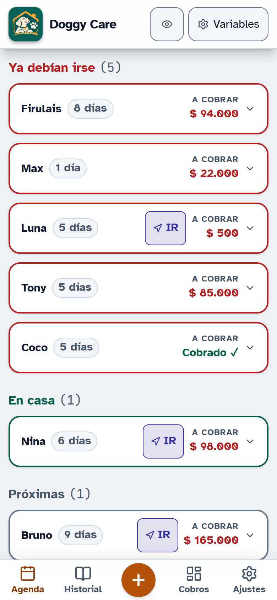
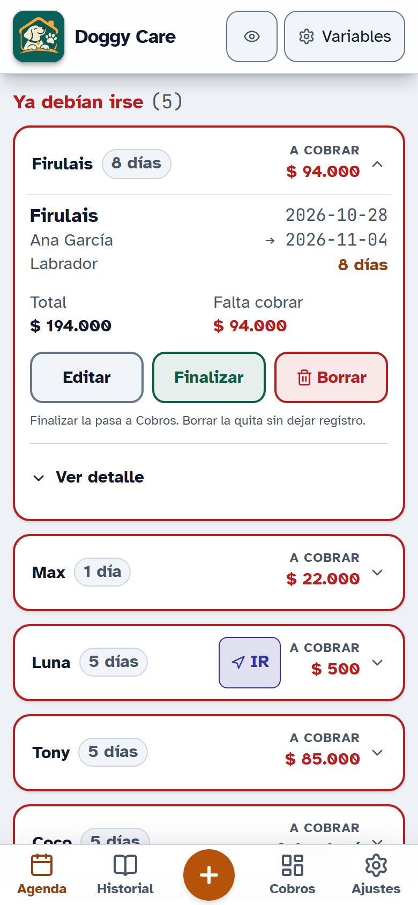
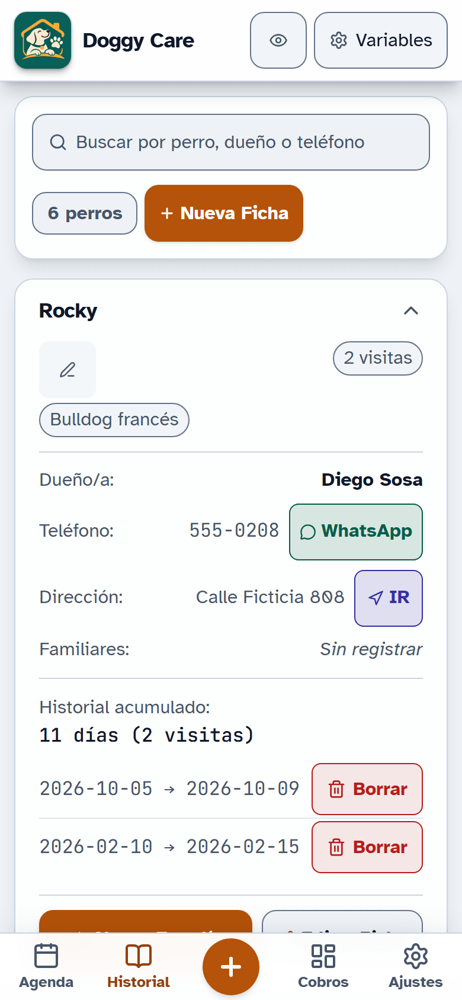
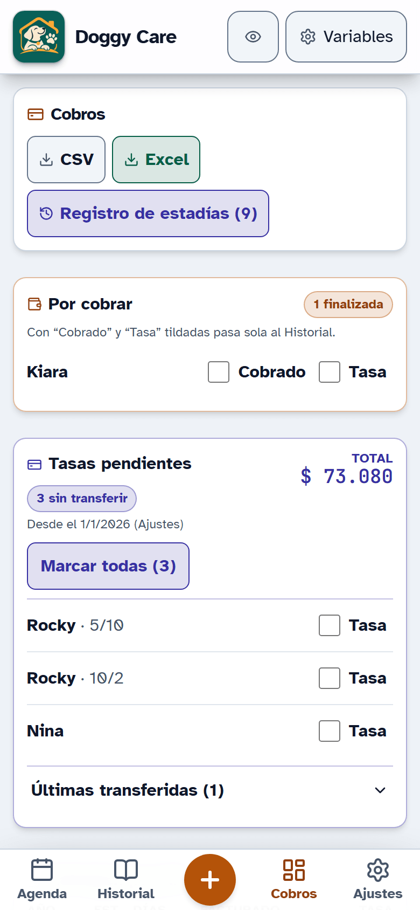
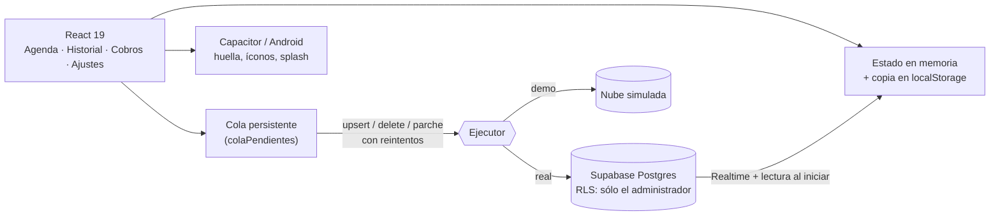

<div align="center">


# Doggy Care

**La agenda, los cobros y las tasas de un pensionado canino, en el teléfono y sin conexión.**

[](https://react.dev/)
[](https://vite.dev/)
[](https://www.typescriptlang.org/)
[](https://tailwindcss.com/)
[](https://capacitorjs.com/)
[](https://supabase.com/)
[](LICENSE)

</div>

<p align="center">
  <picture>
    <source media="(prefers-color-scheme: dark)" srcset="docs/img/agenda-oscuro.png">
    
  </picture>
  <picture>
    <source media="(prefers-color-scheme: dark)" srcset="docs/img/agenda-detalle-oscuro.png">
    
  </picture>
  <picture>
    <source media="(prefers-color-scheme: dark)" srcset="docs/img/historial-oscuro.png">
    
  </picture>
  <picture>
    <source media="(prefers-color-scheme: dark)" srcset="docs/img/cobros-oscuro.png">
    
  </picture>
</p>

<p align="center"><sub>Capturas del modo demo a 390 px con datos ficticios. Se ven en claro u oscuro según el tema de GitHub.</sub></p>

## Qué resuelve

Un pensionado canino llevaba sus estadías en una planilla: quién está en casa, quién llega, cuánto falta cobrar y qué porcentaje (la "tasa") hay que transferir de cada cobro. Doggy Care reemplaza esa planilla con una app pensada para usar con una mano, en el día a día, por un único administrador:

- **Sin conexión.** Cada cambio queda guardado en el teléfono y se sube solo cuando vuelve la señal.
- **Nada se pierde en silencio.** Siempre se ve si hay cambios pendientes de subir y qué falló.
- **Los números cierran.** Los cálculos de cobros y tasas están probados contra los de la planilla original ([docs/calculos.md](docs/calculos.md)).

## Funciones

| Área | Qué hace |
|---|---|
| **Agenda** | Estadías agrupadas por estado (ya debían irse, en casa, próximas). Muestra lo que falta cobrar y abre Waze hacia la dirección del dueño con un toque. Las acciones son Editar, Finalizar y Borrar, con confirmación. |
| **Historial** | Una ficha por perro con dueño, teléfono (WhatsApp), dirección, familiares y estadías pasadas. Junta los nombres escritos distinto ("Ramón", "ramon "). El borrado real se puede deshacer durante 10 segundos, y además queda una copia en "Borrados recientes". |
| **Cobros** | El flujo es Agenda → Finalizar → *Por cobrar* → Cobrado + Tasa → Historial. Lista las tasas pendientes perro por perro, permite "Marcar todas" y muestra un resumen por año. |
| **Tasas** | La tasa sale del año de la fecha de fin (por ejemplo, 18 % en 2026 y 19 % en 2027) y hay una fecha de inicio configurable. Infiere el año de las fechas viejas "día/mes". |
| **Modo privacidad** | Oculta teléfonos, direcciones, familiares y dueños en pantalla, en la búsqueda y en las exportaciones. |
| **Exportes** | CSV, Excel (HTML) y respaldo completo en JSON, sólo de lectura. |
| **Cola offline** | Las operaciones se guardan ordenadas y agrupadas, con reintentos. Distingue errores de sesión, de red y permanentes. |
| **Android** | Capacitor 8, bloqueo opcional con huella, íconos adaptativos y pantalla de inicio. |

## Probarlo en 1 minuto (modo demo)

```bash
git clone https://github.com/MSSimonet/doggy-care.git
cd doggy-care
npm install
npm run demo
```

Abrí <http://localhost:5173>. El demo usa datos ficticios y una nube simulada en memoria, sin cuenta ni base de datos. En Cobros está "Kiara", lista para probar el flujo Cobrado + Tasa.

## Arquitectura



- **Lectura.** Al iniciar sesión se leen las cuatro tablas, y Realtime avisa cuando cambian las estadías.
- **Escritura.** Toda escritura pasa por la cola (`src/lib/colaPendientes.ts` y `src/lib/escrituras.ts`). Las operaciones relacionadas (archivar = crear el registro + quitar de la Agenda) viajan como grupo, en orden: si una falla, las que siguen del grupo esperan, y quien usa la app decide reintentar o descartar. Si la base todavía no tiene una columna opcional, se guarda sin ella y se avisa.
- **Cálculos.** Son funciones puras en `src/utils/` (cobros, tasas, orden y fechas), con pruebas unitarias.

## Instalación con tu propia base

1. Creá un proyecto en [Supabase](https://supabase.com/) y un usuario en *Authentication → Users*.
2. En el *SQL Editor* corré `supabase_schema.sql`. Antes, reemplazá el UUID de marcador por el de tu usuario. Después corré las migraciones `003` a `005` de `supabase/migrations/`.
3. Copiá `.env.example` a `.env.local` y completá:
   ```env
   VITE_SUPABASE_URL=https://<tu-proyecto>.supabase.co
   VITE_SUPABASE_ANON_KEY=<clave pública>
   ```
4. Corré `npm run dev` y entrá con el usuario del paso 1.

La guía completa, con Vercel y Android, está en [docs/despliegue.md](docs/despliegue.md) y [docs/android.md](docs/android.md).

## Base de datos

| Tabla | Contenido |
|---|---|
| `stays` | Estadías de la Agenda y las finalizadas que esperan cobro. |
| `historical_stays` | Registro de estadías archivadas, con la tasa y su tilde de transferida. |
| `clients_directory` | Fichas de perros y dueños. |
| `app_config` | Tarifas, cotizaciones, tasas por año y fecha de inicio. |

| Migración | Qué hace |
|---|---|
| `001_auth_rls.sql` | Quita el acceso de `anon` y crea las políticas de sólo-administrador. |
| `002_limpieza.sql` | Normaliza fechas viejas "día/mes". |
| `003`–`005` | Agregan la tasa por estadía, el id del perro, el monto y la fecha de transferencia, y las tasas por año. |

## Scripts

| Comando | Para qué |
|---|---|
| `npm run dev` | Servidor de desarrollo con tu base. |
| `npm run demo` | Servidor de desarrollo con datos ficticios. |
| `npm run build` | Chequeo de tipos y build de producción en `dist/`. |
| `npm run typecheck` | Sólo TypeScript. |
| `npm test` | Pruebas (Vitest y jsdom). |
| `npm run medir` | Mide contraste, foco, tamaño de controles y desborde en claro y oscuro, con el demo corriendo. Escribe [docs/medicion.md](docs/medicion.md). |
| `npm run iconos` | Regenera íconos y splash desde `assets/logo.png`. |
| `npm run android:sync` / `android:open` | Build y sincronización con el proyecto Android. |

## Decisiones técnicas

- **Offline primero, sin perder datos.** La cola persistente es ordenada y agrupada. Separa errores de sesión, de red y permanentes, y nunca descarta un cambio sin avisar.
- **Fechas sin año.** El historial importado trae "día/mes". El año real se infiere recorriendo la planilla en orden y se usa en la lista de tasas, en el resumen por año y en las listas.
- **Seguridad simple y explícita.** La app tiene un solo administrador: RLS con `auth.uid()` fijo, sin roles ni tablas de permisos. La clave pública vive en el cliente y la base hace cumplir las reglas.
- **Accesibilidad medida, no supuesta.**
  - Contraste AA y foco visible, en claro y oscuro.
  - Controles de 44 px o más.
  - Sin desborde a 360 px.
  - Se verifica con `npm run medir`.
- **Un flujo de plata sin migración.** El estado "finalizada" reutiliza una columna existente, para no tocar la base en producción.

## Estructura

```
src/
  App.tsx              pantalla principal y estado
  components/          modales, tarjetas y casillas (StayModal, HistoryModal, PorCobrar…)
  lib/                 cola offline, Supabase, respaldo, huella, privacidad
  utils/               cálculos puros: cobros, tasas, fechas, orden, Waze
  data/                datos ficticios del demo
supabase/              esquema inicial y migraciones
android/               proyecto nativo de Capacitor
scripts/               medición de accesibilidad e íconos
docs/                  cálculos, despliegue, Android, seguridad, capturas
```

## Hacia dónde va

- **Direcciones de clientes:** editar, agregar y quitar la dirección desde la ficha y desde la estadía, con Waze en un toque.
- **Tasas por perro:** ver de un vistazo qué falta transferir por cada perro y el historial de lo ya transferido.
- **Cola offline:** más visibilidad de los cambios pendientes y reintentos más inteligentes cuando vuelve la señal.
- **Demo online:** una versión publicada con datos ficticios para probar la app sin instalar nada.

## Licencia

[MIT](LICENSE) © Marcelo Simonet
